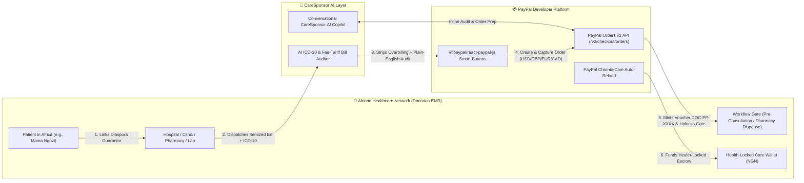

# Docarion CareSponsor AI 🌍🩺💳

**Cross-Border Diaspora Healthcare Guarantor, AI Medical Bill & Prescription Auditor, and Health-Locked Care Wallet Powered by PayPal & AI**

[](./LICENSE)
[](https://developer.paypal.com)
[](#architecture)

---

## 🚨 The Problem

Every day across the African diaspora (in the US, UK, Canada, and Europe), millions of people receive urgent messages from home:
> *"Mama is at the hospital—send money for lab tests and medications right away."*

Today, caring for aging parents or relatives across borders is broken in three fundamental ways:
1. **Fragmented Provider Blindness:** Family members abroad don't know which clinic, pharmacy, or lab their relative visited, or how to pay that facility directly.
2. **Medical Overbilling & Unverified Prescriptions:** Diaspora sponsors have no way to verify whether an itemized hospital/pharmacy bill is clinically appropriate for the diagnosis or inflated by 2–3x.
3. **Cross-Border Payment Friction & Cash Diversion:** International cards frequently fail on local African payment gateways, while informal cash remittances carry high fees and no guarantee that funds are spent on chronic medications or clinical care.

---

## 💡 The Solution: Docarion CareSponsor AI

**Docarion CareSponsor AI** introduces the **Diaspora Care Sponsor (Financial Guarantor)** directly into the healthcare journey:

1. **Unified Care Circle Routing:** A patient in Africa adds their family member abroad as a **Care Sponsor / Financial Guarantor** on their Docarion profile. Whenever the patient visits *any* connected hospital, clinic, laboratory, or pharmacy, the itemized encounter bill routes automatically to the Sponsor's dashboard—no hunting down hospital bank accounts.
2. **🧠 AI Clinical & Fair-Price Bill Auditor:** Before the Sponsor pays a single dollar, our AI Auditor cross-checks every line item against **ICD-10 clinical guidelines** and **regional hospital/pharmacy fair-tariff ceilings**:
   - Flags clinically unindicated medications (e.g., an expensive IV reserve antibiotic added onto an uncomplicated outpatient malaria visit) and duplicate administrative fees.
   - Caps overpriced diagnostic tests at verified regional fair benchmarks.
   - Translates medical jargon into a reassuring **Plain-English Family Summary**.
3. **💳 Instant Cross-Border Settlement via PayPal (`USD` / `GBP` / `EUR` / `CAD` → `NGN`):**
   - **Direct Provider Bill Settlement (`PayPal Orders v2` & `Pay in 4`):** Settle audited bills in one click via PayPal. Capturing the PayPal order immediately mints a cryptographic **Docarion Care Voucher (`DOC-PP-XXXX`)** and unlocks the patient's pre-consultation or pharmacy dispensation gate in real time.
   - **Health-Locked Care Wallet & Chronic-Care Auto-Reload:** Pre-fund a family member's **Health-Locked Care Wallet** via PayPal (with category guardrails and recurring monthly **PayPal Auto-Reload** for chronic hypertension/diabetes refills). Funds are strictly locked to verified medical care and cannot be cashed out.
4. **🤖 Conversational CareSponsor AI Copilot:** An interactive AI agent that audits pending bills, calculates monthly chronic medication budgets, and prepares inline **PayPal Checkout** actions directly inside the chat.

---

## 🏗️ System Architecture



---

## 🚀 Quick Start (Setup & Run Instructions)

### Prerequisites
- **Node.js** `>= 18.17` (tested on Node 20 / 22 / 26)
- **npm** `>= 9`

### 1. Clone & Install Dependencies
```bash
git clone <your-public-repo-url>
cd docarion-caresponsor-ai
npm install
```

### 2. Configure Environment Variables (Optional — Works Out-of-the-Box!)
Copy `.env.example` to `.env.local`:
```bash
cp .env.example .env.local
```
- **PayPal Sandbox Credentials:** You can add your `NEXT_PUBLIC_PAYPAL_CLIENT_ID`, `PAYPAL_CLIENT_ID`, and `PAYPAL_CLIENT_SECRET` from [developer.paypal.com](https://developer.paypal.com/dashboard/applications/sandbox) (or paste your Client ID directly in the UI's **PayPal Sandbox Keys** top drawer). If left at the default `test` value, the app runs seamlessly using PayPal JS SDK's Sandbox test mode + our deterministic PayPal Orders v2 Sandbox engine.
- **Google Gemini API Key:** Add `GEMINI_API_KEY` to enable live Gemini `gemini-2.5-flash` narrative generation alongside the deterministic ICD-10 Pharmacology & Tariff Audit Engine.

### 3. Run the Development Server
```bash
npm run dev
```
Open **[http://localhost:3095](http://localhost:3095)** in your browser.

### 4. Run Automated Tests & Typecheck
```bash
npm run typecheck
npm test
npm run build
```

---

## 🧪 60-Second Judge Walkthrough (All 4 Interactive Tabs)

1. **Tab 1 — 🌍 Diaspora Care Sponsor Hub:**
   - View **Mama Ngozi Okafor's** live hospital & pharmacy bill (`DOC-INV-2026-9041`) routed from *Lagos Lagoon Specialist Hospital* (`₦104,000` / `$64.20 USD`).
   - Click **"1. Run AI Clinical & Fair-Price Audit"**: Watch the AI verify her malaria & hypertension medications while flagging an unindicated IV Meropenem antibiotic (`₦42,000`) and a 2.5x overpriced Malaria RDT (`₦24,000 → ₦9,500`).
   - Click **"Apply AI Verified Fair-Price Adjustment (Save $34.88 USD)"** to drop the payable total to **$29.32 USD (`₦47,500 NGN`)**.
   - Click **"Pay $29.32 USD with PayPal"** to execute the PayPal Orders v2 create + capture flow, minting voucher `DOC-PP-XXXX` and unlocking her pharmacy dispensation gate!
2. **Tab 2 — 💳 Health-Locked Care Wallet & Auto-Reload:**
   - Toggle category-locked spending guardrails (`Prescriptions`, `Consultations`, `Labs`, `Inpatient`; `Cash Withdrawal Blocked`).
   - Top up any family member's wallet in `USD`, `GBP`, `EUR`, or `CAD` via PayPal or enable a monthly **PayPal Auto-Reload** for chronic medications.
3. **Tab 3 — 🏥 African Provider & Guarantor Simulator:**
   - Act as the patient or hospital in Africa: link a new **Diaspora Care Sponsor** to a patient's chart, dispatch a new live clinical scenario (including an overbilled Endocrinology encounter or an Emergency ESI-1 triage encounter), and watch the **Live Facility Workflow Gate Monitor** flip from `🔒 GATE LOCKED` to `✅ UNLOCKED` upon PayPal payment.
4. **Tab 4 — 🤖 CareSponsor AI Copilot & PayPal API Telemetry Inspector:**
   - Chat with the AI Copilot to audit bills or calculate chronic medication budgets and launch PayPal Checkout inline.
   - Inspect live JSON request/response payloads for `POST /v2/checkout/orders`, `POST /v2/checkout/orders/{id}/capture`, and `POST /api/ai/audit-bill`.

---

## 📄 License
Released under the [MIT License](./LICENSE).
