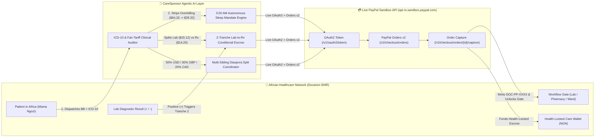

# Docarion CareSponsor AI 🌍🩺💳

**Autonomous Agentic PayPal + Clinical AI Engine for Cross-Border Diaspora Healthcare Sponsorship, ICD-10 Medical Bill Auditing, Staged Lab-to-Rx Escrow & Multi-Sibling Pool Settlement**

[](./LICENSE)
[](https://developer.paypal.com)
[](#architecture)

---

## 🚨 Why Standard Checkout Fails Cross-Border Healthcare

Every day across the African diaspora (in the US, UK, Canada, and Europe), millions of people support the medical care of aging parents and relatives back home. Yet a traditional "click a button to pay" checkout fails in real-world clinical emergencies for **four critical reasons**:

1. **The 3:00 AM Time-Zone Trap:** When Mama arrives at a clinic in Lagos at **9:15 AM WAT**, her son in Houston or California is fast asleep at **2:15 AM CST**. Under manual checkout, an elderly parent sits on a hospital bench for 5 hours waiting for their family sponsor abroad to wake up and click Pay.
2. **Medical Overbilling & Unindicated Drugs:** Hospitals frequently bundle expensive, clinically unindicated medications (e.g., reserve IV carbapenems on an uncomplicated outpatient malaria visit) or inflate diagnostic test prices 2–3x.
3. **Premature Upfront Drug Billing Before Lab Results:** Clinics routinely bill for both diagnostic lab tests and expensive prescription drugs upfront—before knowing whether the lab test is even positive.
4. **Single-Sponsor Diaspora Burden:** One sibling abroad typically gets stuck paying 100% of every family medical bill because coordinating splits across siblings in the US (`USD`), UK (`GBP`), and Canada (`CAD`) over WhatsApp is slow and fragmented.

---

## 🚀 Our 3 Agentic PayPal + AI Innovations

Rather than treating PayPal as a passive checkout button, **Docarion CareSponsor AI** turns **PayPal Orders v2** into an **autonomous, clinically governed programmable payment engine** where the AI Agent controls *when*, *how much*, and *under what clinical proof* PayPal moves money:

### 1. 🌙 Autonomous "3:00 AM While You Sleep" AI PayPal Mandate (Zero-Click Agentic Settlement)
- Diaspora sponsors configure a **Programmable AI PayPal Mandate** (e.g., *"Auto-settle bills up to `$60 USD` via PayPal while I'm asleep **only if** the AI Clinical Auditor confirms `≥ 90%` ICD-10 diagnosis-to-drug concordance and strips any inflated line items"*).
- When a clinic in Lagos dispatches a bill at **9:15 AM WAT (`2:15 AM Houston`)**, the AI Agent autonomously:
  1. Audits every line item against **ICD-10 guidelines** and regional fair-tariff benchmarks.
  2. Strips unindicated drugs (`₦42,000` IV Meropenem removed) and caps overpriced labs (`₦24,000 → ₦9,500`), cutting the bill from **`$64.20 USD` → `$29.32 USD`**.
  3. Verifies `$29.32 ≤ $60.00` mandate ceiling and autonomously executes `POST /v2/checkout/orders` & `/capture` via the **PayPal Sandbox API** in 2 seconds—unlocking Mama's pharmacy gate while her son sleeps and delivering a morning audit & receipt summary.

### 2. 🧪 Clinical-Proof Staged Release (Lab-Result-Triggered PayPal Escrow)
- Instead of paying for both lab diagnostics and medications blindly upfront, the AI splits the PayPal settlement into **2 Clinical-Proof Tranches**:
  - **Stage 1 (Consultation + Lab Gate — `$15.12 USD`):** AI immediately creates & captures **PayPal Order #1 (`$15.12 USD`)** so the patient can see the doctor and complete their Malaria RDT blood test.
  - **Stage 2 (Pharmacy Medications — `$14.20 USD` Held in Escrow):** The AI holds the medication tranche until the laboratory posts the verified diagnostic result into the Docarion EMR:
    - If **`Positive (+)`**: AI automatically executes **PayPal Order #2 (`$14.20 USD`)** and unlocks the Pharmacy Dispensation Gate.
    - If **`Negative (-)`**: AI automatically **voids/cancels Tranche 2**, saving the sponsor **`$14.20 USD`** on unnecessary drugs!

### 3. 👨‍👩‍👧‍👦 AI Multi-Sibling Diaspora Pool Split (Multi-Currency Parallel PayPal Orders)
- Instead of one child abroad bearing 100% of every medical bill, the AI coordinates a **Family Care Pool** across siblings in their own local currencies:
  - **Chidi Okafor (Houston, USA — 50%):** `$14.66 USD` via `POST /v2/checkout/orders` (`USD`)
  - **Adaeze Okafor-Smith (London, UK — 30%):** `£6.95 GBP` (`$8.80 USD` eq.) via `POST /v2/checkout/orders` (`GBP`)
  - **Obinna Okafor (Toronto, Canada — 20%):** `CA$7.98 CAD` (`$5.86 USD` eq.) via `POST /v2/checkout/orders` (`CAD`)
- All 3 live PayPal Sandbox Orders are aggregated into a single **`100% NGN` (`₦47,500`)** instant hospital voucher (`DOC-POOL-XXXX`).

---

## 🗺️ Complete 6-Page End-to-End Patient-to-Sponsor Journey

| Page | Perspective | What You Experience |
| :--- | :--- | :--- |
| **Page 1: Patient Dashboard** | 🇳🇬 Patient in Africa (*Mama Ngozi*) | Invite a family member abroad as a Care Sponsor, or compose & send a new itemized hospital/pharmacy bill with a personal note to your sponsor abroad. |
| **Page 2: Sponsor Invitation** | 🌍 Family Member Abroad (*Chidi*) | View the incoming Care Sponsor invitation card, inspect verified patient identity (`DOC-PAT-2026-8841`), and click **Accept Invitation & Activate Link**. |
| **Page 3: Agentic PayPal & Bills** | 🧠 AI + PayPal Command Center | Experience all **3 Agentic PayPal Innovations** (**3:00 AM Autonomous Mandate**, **2-Tranche Lab→Rx Escrow**, and **Multi-Sibling USD/GBP/CAD Pool Split**) plus line-by-line ICD-10 clinical bill auditing and manual PayPal Smart Button checkout. |
| **Page 4: Fund Care Wallet** | 💳 Diaspora Sponsor | Pre-fund a **Health-Locked Care Wallet** via PayPal (`USD`/`GBP`/`EUR`/`CAD` → `NGN`) with category guardrails (`Cash-Out Blocked`) and monthly **PayPal Auto-Reload**. |
| **Page 5: Visit Records & Rx** | 🩺 Longitudinal Clinical View | Inspect complete doctor consultation notes, vital signs, ICD-10 diagnoses, lab test results, and verified prescriptions for every sponsored visit. |
| **Page 6: Transactions & API Log** | 📜 Audit & PayPal Telemetry | View every cross-border PayPal receipt, minted `DOC-PP-XXXX` voucher code, and live `POST /v2/checkout/orders` & `/capture` JSON telemetry from `api-m.sandbox.paypal.com`. |

---

## 🏗️ System Architecture



---

## 🚀 Quick Start (Setup & Run Instructions)

### Prerequisites
- **Node.js** `>= 18.17`
- **npm** `>= 9`

### 1. Clone & Install Dependencies
```bash
git clone <your-public-repo-url>
cd docarion-caresponsor-ai
npm install
```

### 2. Configure Environment Variables
Copy `.env.example` to `.env.local`:
```bash
cp .env.example .env.local
```
Add your **PayPal Developer Sandbox** credentials (`NEXT_PUBLIC_PAYPAL_CLIENT_ID`, `PAYPAL_CLIENT_ID`, `PAYPAL_CLIENT_SECRET`) from [developer.paypal.com](https://developer.paypal.com/dashboard/applications/sandbox).

### 3. Run the Development Server
```bash
npm run dev
```
Open **[http://localhost:3095](http://localhost:3095)** in your browser.

### 4. Run Automated Tests & Typecheck
```bash
npm run typecheck
npm test
npm run build
```

---

## 📄 License
Released under the [MIT License](./LICENSE).
